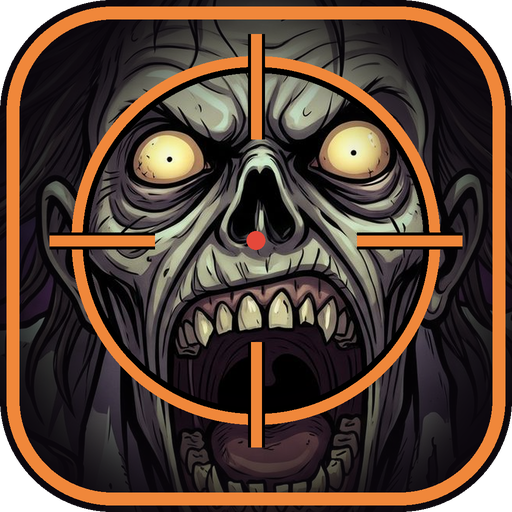

# 마지막 방어선

모래주머니 바리케이드 뒤에서 소총 한 자루로 끝없이 몰려오는 좀비를 막는 모바일 웹 저격 게임입니다. 한 번 물리면 끝납니다.

## 플레이 방법

- 휴대폰을 **가로**로 들고 정면을 본 채 **방어 시작**을 누르세요. 그 방향이 정면이 됩니다.
- **좌우로 돌리기**: 시선 이동 / **앞뒤로 기울이기**: 위아래 조준
- 왼쪽 **조준경** 버튼: 짧게 누르면 켜고 끄기, 길게 누르면 누르는 동안만 확대
- 오른쪽 **사격** 버튼: 볼트액션 5발. 탄약 표시를 누르면 미리 장전합니다.
- 머리는 한 방. 맨눈으로 쏘면 총알이 퍼집니다.
- 코앞에서 웅크렸다 뛰어드는 **공중의 순간**이 마지막 기회입니다.
- 시선이 틀어지면 오른쪽 위 ◎ 버튼으로 정면을 다시 맞추세요.

## 좀비

| 종류 | 특징 |
|---|---|
| 걷는 좀비 | 기본. 머리 1발, 몸 2발 |
| 달리는 좀비 | 빠름. 1발 |
| 기는 좀비 | 낮게 기어 와서 맞히기 어려움 |
| 뚱보 좀비 | 느리지만 튼튼함 |
| 거인 좀비 | 5웨이브마다 등장 |

배경은 2웨이브마다 바뀝니다: 해질녘 폐허 거리 → 달밤 고속도로 → 안개 낀 마을 → 불타는 도시.

## 알아둘 점

- 기울기·자이로 센서는 **HTTPS 주소**에서만 켜집니다. 내려받은 파일을 직접 열면 센서가 꺼지니 GitHub Pages 주소로 여세요.
- 아이폰은 시작할 때 동작 센서 권한을 '허용'해야 하며, 웹 진동은 지원되지 않습니다.
- 브라우저 메뉴의 **홈 화면에 추가**로 설치하면 앱처럼 실행되고, 한 번 연 뒤에는 오프라인에서도 됩니다.

## 파일 구성

| 파일 | 내용 |
|---|---|
| `index.html` | 게임 전체 (그림·배경음악 포함 단일 파일) |
| `manifest.webmanifest` | 홈 화면 설치 정보 |
| `sw.js` | 오프라인 실행용 서비스 워커 |
| `icons/` | 앱 아이콘 (1024 / 512 / 192 / 180 / 32px) |

## 사용한 소재

- 배경·좀비·조종 화면 그림: 이미지 생성 AI로 제작
- 배경음악: `yevhenastafiev – scary horror` (원 출처의 라이선스 조건을 확인 후 사용하세요)
